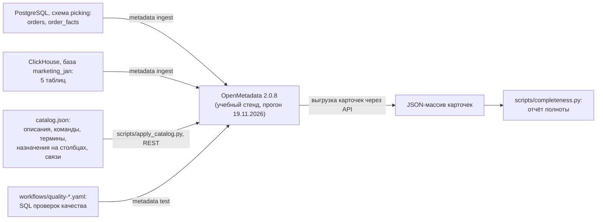

# Каталог учебных данных в OpenMetadata — конспект

## 1. Зачем

Что сделано: подготовила Docker-стенд OpenMetadata и конфигурации сбора метаданных для PostgreSQL и ClickHouse, описания, владельцев, глоссарий, проверки качества и отчёт о полноте. 19 ноября 2026 года стенд один раз запущен в GitHub Codespaces. Каталог OpenMetadata 2.0.8 собрал метаданные обоих источников и принял описания, владельцев, термины и связи. Итоговые проверки прошли все, 12 из 12. Это один автоматический прогон на учебном стенде: интерфейс каталога в нём глазами не открывался. Это освоение инструмента в учебном проекте, а не рабочая практика. Опыта администратора или аналитика промышленного каталога данных и роли Data Steward не было, это говорится прямо.

Итог одной фразой (из [BRIEF](BRIEF.md)): для двух учебных источников я подготовила конфигурации сбора, описала семь объектов и их связи по SQL, сопоставила девять столбцов с терминами глоссария и проверила на контрольных снимках, как выявить пробелы в карточках и назначениях на столбцах, а в одном прогоне учебного стенда OpenMetadata 2.0.8 каталог собрал все семь объектов, принял описания, владельцев, термины и шесть связей, сохранил их при повторном сборе и записал результаты двух проверок качества.

Статус — принят 19 ноября 2026 года. Офлайн-часть проверена без каталога: официальным парсером клиента OpenMetadata, в PostgreSQL 16.10 и `clickhouse-local`, на синтетических снимках карточек. Поведение самого каталога проверено одним прогоном стенда (`stand/`, один скрипт `stand/run.sh`), результаты — в разделе 5. Что из этого следует и чего не следует — в разделе 8.

## 2. Задача простыми словами

В компании много таблиц, и аналитик часто не знает, что лежит в таблице, кто за неё отвечает и откуда берутся её данные. Каталог данных собирает эти сведения в одном месте: для каждой таблицы — описание, владелец, термины из общего словаря и связи «эта таблица построена из тех». В проекте я готовлю такой каталог для двух учебных баз: PostgreSQL с заказами склада и ClickHouse с маркетинговой атрибуцией. Ещё нужно уметь измерить, насколько каталог заполнен, и автоматически ловить ошибки в самих данных. Эти части я сделала так, чтобы их можно было проверить и без запущенного каталога, а потом проверила их на стенде с каталогом.

## 3. Как устроено



- **Источники.** PostgreSQL — база и схема `picking` из соседнего учебного проекта сборки заказов (`metabase-order-picking`): таблица `orders` и представление `order_facts`, которое считает из времени создания заказа календарный день в UTC, время ожидания и время сборки. ClickHouse — база `marketing_jan` из учебного проекта маркетинговой воронки (`marketing-funnel-datalens`): `events` (события пользователей), `spend` (расходы по каналам), `attribution` (доли каналов в подписке), `channel_metrics` (канальная витрина) и `user_funnel` (воронка).
- **Сбор метаданных (ingestion).** Программа `metadata` из пакета `openmetadata-ingestion` подключается к базе, читает её схему (таблицы, столбцы, типы, SQL представлений) и отправляет результат в API каталога. Что читать и куда отправлять, задаёт YAML-конфигурация: `workflows/postgres.yaml` и `workflows/clickhouse.yaml`. Фильтры оставляют только семь нужных объектов. Перезапись описаний выключена (`overrideMetadata: false`), чтобы повторный сбор не стирал ручные описания. Пометка исчезнувших объектов как удалённых тоже выключена: выборка частичная, и пометка могла бы задеть объекты, которые уже есть в каталоге, но не попали в фильтр.
- **Описания и владельцы.** Для каждого из семи объектов в `catalog.json` записаны описание и учебная команда-владелец: `p28_fulfillment` для заказов и `p28_marketing` для маркетинговых таблиц.
- **Глоссарий.** Словарь `LabMetrics` из семи терминов: заказ на сборку, время сборки, маркетинговое событие, расходы канала, доля подписки, CPA канала, шаг воронки. Каждой таблице назначается основной термин, а девяти столбцам — свои термины (например, `order_facts.pick_seconds` — «время сборки»).
- **Связи происхождения (lineage).** Шесть прямых связей выписаны вручную из SQL исходных проектов: `order_facts` читает `orders`; `attribution` и `user_funnel` читают `events`; `channel_metrics` читает `events`, `spend` и `attribution`.
- **Проверки качества.** Два SQL-теста в формате OpenMetadata (`tableCustomSQLQuery`): заказы с пропущенными или противоречивыми количествами и пары «конверсия, модель» с неверными весами атрибуции. Оба запроса возвращают число нарушений, ожидается ноль.
- **Отчёт полноты.** Скрипт `scripts/completeness.py` получает выгрузку карточек из API каталога и считает, у скольких из семи ожидаемых объектов есть описание, верная команда и подтверждённый термин, а с ключом `--columns` — сколько из девяти назначений на столбцах подтверждены.

## 4. По шагам

1. **Конфигурации сбора.** Для каждой базы — свой YAML с адресом, учётными данными из переменных окружения и фильтрами. Ключевая особенность ClickHouse: в коннекторе OpenMetadata имя базы ClickHouse передаётся в поле `databaseSchema`, потому что в модели каталога ClickHouse-база играет роль схемы. Проверка — тесты, которые читают файлы штатным загрузчиком CLI, подставляют фиктивные переменные, разбирают конфигурацию официальным парсером и проверяют фильтры. Штатными фильтрами OpenMetadata проверено, что архивные копии (`<таблица>_archive`) и `information_schema` отсекаются. Контрольный набор имён проверен теми же шаблонами через `re.match` без учёта регистра, как их применяет OpenMetadata: пропущены `orders`, `order_facts` и пять маркетинговых таблиц, отклонены `orders_archive`, `users`, `events_staging`, `tmp_attribution` и `query_log`. Без учёта регистра пройдут и `ORDERS` или `Order_Facts`, если такие объекты появятся в источнике. Ещё один тест сравнивает в обе стороны объекты, которые создаёт DDL стенда и оставляют фильтры, с объектами `catalog.json`: совпали 2 из 2 в PostgreSQL и 5 из 5 в ClickHouse. Это сверка с DDL, а не с выгрузкой настоящего каталога. В выгрузке со стенда после первого сбора оказались все 7 объектов под ожидаемыми именами.
2. **Спецификация каталога.** В `catalog.json` для каждого объекта по полному имени (FQN) записаны описание, команда, термин и входящие связи. Группы, глоссарий и термины проверены моделями запросов клиента OpenMetadata: модели их приняли, значит, формат подходит для отправки в API. Полные имена ClickHouse-таблиц записаны в виде `p16_marketing.default.marketing_jan.<таблица>`: что коннектор поставит на место базы `default`, было допущением. Прогон стенда его подтвердил: у карточек база — `p16_marketing.default`, схема — `p16_marketing.default.marketing_jan`.
3. **Отчёт полноты.** Знаменатель — всегда семь ожидаемых объектов, даже если карточка пропала или помечена удалённой. Поэтому потеря карточек при сборе снижает полноту, а не исчезает из отчёта. Отчёт перечисляет пробелы по каждому объекту: например, у `order_facts` в контрольном снимке есть описание, но назначена не та команда (`p28_marketing` вместо `p28_fulfillment`) и нет подтверждённого термина. Для столбцов термин засчитывается, только если он из глоссария и в состоянии `Confirmed`; предложенный термин или метка из классификатора не засчитываются.
4. **Проверки качества.** Для заказов: `requested > 0` и `0 ≤ errors ≤ picked ≤ requested`, пропуски недопустимы. Для атрибуции проверка идёт по каждой паре «конверсия, модель»: каждый вес в интервале (0, 1] и конечен, сумма весов равна единице с точностью 10⁻⁹. Сумма считается в Float64, и на границе это важно: у весов 0,5 и 0,500000001 сумма в десятичной записи отклоняется от единицы ровно на 10⁻⁹, а в двойной точности — примерно на 1,00000008·10⁻⁹. Поэтому к допуску добавлен запас 10⁻¹² на округление: ошибкой считается отклонение больше 10⁻⁹ + 10⁻¹², то есть границы 1 ± 10⁻⁹ включены, а отклонение до 10⁻⁹ + 10⁻¹² тоже проходит. Почему по паре, а не по итогу: если линейная модель дала подписке 0,8, а модель с затуханием — 1,2, то вместе это 2, как и положено для двух моделей, и общий итог ошибку скроет. SQL проверен напрямую в PostgreSQL 16.10 и в `clickhouse-local` 24.8.14.39 (тот же движок SQL, без сервера) на корректных и на испорченных данных. В YAML у обеих проверок `strategy: COUNT`, `operator: '<='`, `threshold: '0'`; что при `COUNT` OpenMetadata сравнивает с порогом именно число из `count(*)`, подтвердил прогон стенда. Запрос всегда возвращает одну строку, но на чистых данных результат — `resultRowCount` = 0 и `Success`. С одной испорченной группой — 1 и `Failed`. Если бы считались строки результата, на чистых данных было бы 1.
5. **Стенд (запущен 19.11.2026).** В `stand/` лежат compose-файл из релиза OpenMetadata 2.0.8 и два источника с копиями схем и синтетических данных соседних проектов. Скрипт `stand/run.sh` проводит весь цикл сам: сбор, выгрузку «до» (если какого-то из семи объектов нет, скрипт останавливается здесь, до первой записи в каталог), применение `catalog.json` через REST (повторное применение не должно ничего менять), повторный сбор, выгрузку «после», отчёт полноты, обе проверки качества и отрицательный контроль. Чтобы доказать, что повторный сбор действительно прошёл по всем таблицам, перед ним в источниках ставится комментарий к одному столбцу каждого объекта с меткой времени прогона: он должен появиться в выгрузке «после» и отсутствовать в выгрузке сразу после применения каталога. Описания, владельцы и термины в этих двух выгрузках должны совпасть. Строка отрицательного контроля удаляется сразу после проверки, и в начале шага проверок тоже, если от прошлого прогона с `KEEP_STAND=1` что-то осталось. Итог — двенадцать проверок в `stand/out/verify.json`. В прогоне 19.11 прошли все двенадцать. Контейнер Airflow не нужен: сбор запускается внешним CLI, а клиент конвейеров на сервере выключен, как предписывает документация. Чего это не доказывает — раздел 8.

## 5. Результаты

Все цифры — из закоммиченных протоколов в `docs/runs/`: полных прогонов CI и одного прогона стенда. На первых четырёх шагах новые тесты сначала падали, потому что ещё не было конфигурации или кода отчёта, и проходили после реализации: красные прогоны `…20261118-184909` (конфигурации), `…20261118-185645` (спецификация и отчёт), `…20261119-013958` (проверки качества), `…20261119-014819` (столбцы); журналы сохранены только для зелёных. На шаге подготовки стенда такого прогона нет: три красных прогона перед зелёным упали по другим причинам — тест искал закреплённый образ одной строкой и в CI не хватало пакета `pytz` (протокол [stand-prep](runs/2026-11-19-stand-prep.md#прогон-ci-с-этими-тестами)).

| Что проверено | Результат | Источник |
|---|---|---|
| Последний полный прогон CI, 19.11.2026 | 72 теста прошли: 17 — выборка, сравнение с DDL стенда и отчёт полноты, 47 — файлы стенда и логика применения каталога и итоговой сверки на подменённом API (без контейнеров), 5 — конфигурации и модели клиента OpenMetadata 2.0.8.0, 3 — SQL проверок качества | [second-audit](runs/2026-11-19-second-audit.md#прогоны), прогон `…20261119-165729` |
| Конфигурации сбора (официальный парсер, без каталога) | Парсер создал `PostgresConnection` и `ClickhouseConnection`; фильтры пропустили нужные объекты и отсекли архивные и служебные | [workflows](runs/2026-11-18-workflows.md) |
| Спецификация (модели клиента, без каталога) | Модели приняли две группы, глоссарий и семь терминов; ссылки спецификации ведут на объявленные объекты | [catalog](runs/2026-11-18-catalog.md) |
| Отчёт полноты на синтетическом снимке | 3 действующие карточки из 7: описание у 2, верная команда у 2, подтверждённый термин у 1, полностью заполнена 1 (`orders`); 1 объект удалён, 3 отсутствуют | [catalog](runs/2026-11-18-catalog.md) |
| Назначения на столбцах, синтетические снимки | Частичный снимок — 2 из 9 подтверждены; полностью размеченный — 9 из 9 | [columns](runs/2026-11-19-columns.md) |
| SQL проверки заказов в PostgreSQL 16.10 | Корректные данные — 0 нарушений; после вставки ошибочных строк — 8 | [quality](runs/2026-11-19-quality.md) |
| SQL проверки атрибуции в `clickhouse-local` 24.8.14.39 | Корректные данные — 0; после вставки ошибок — 5 групп (суммы 0,8 и 1,2, отрицательный вес, нулевой вес, NaN) | [quality](runs/2026-11-19-quality.md) |
| Граница допуска суммы весов, `clickhouse-local` | Прежний запрос посчитал ошибкой 3 из 4 пар с десятичной суммой ровно 1 ± 10⁻⁹ (например, 0,5 + 0,500000001 дало отклонение 1,00000008·10⁻⁹). После добавления запаса 10⁻¹² — 0 из 4 на границе и 4 из 4 за ней | [second-audit](runs/2026-11-19-second-audit.md#замечание-1-измерение-в-clickhouse) |

Что из этого следует: конфигурации корректны для клиента 2.0.8; из объектов DDL стенда и из контрольного набора имён фильтры оставляют ровно семь объектов `catalog.json` — на выборку в настоящем каталоге это не распространяется; спецификация в формате каталога; отчёт полноты правильно считает пробелы на трёх видах снимков; SQL обеих проверок ловит ошибочные строки в PostgreSQL и в `clickhouse-local`. Про поведение самого каталога эти цифры ничего не говорят — его показал прогон стенда.

**Прогон стенда, 19.11.2026.** GitHub Codespaces: 4 vCPU, 15 ГБ памяти, Docker 29.9.3, Docker Compose v5.8.0, Python 3.11.18. Исполнялся снимок коммита `1262781`. Код возврата 0, 12 из 12 проверок, 6 мин 25 с. Числа — из сохранённой выгрузки [runs/2026-11-19-stand/](runs/2026-11-19-stand/), разбор — в [протоколе](runs/2026-11-19-stand.md).

| Что проверено на стенде | Результат | Файл |
|---|---|---|
| Первый сбор | Все 7 объектов под ожидаемыми FQN, `order_facts` — `View`; у карточек ещё нет описания, команды и термина (0 из 7), термины на столбцах — 0 из 9 | `before_completeness.json` |
| Первое применение `catalog.json` | 23 изменения: 2 команды, глоссарий, 7 терминов, PATCH каждой из 7 таблиц (30 операций), 6 связей | `apply_1.json` |
| Повторное применение | 0 изменений | `apply_2.json` |
| Повторный сбор | Комментарий-метка столбца появился у 7 из 7 объектов; описания, владельцы и метки глоссария не изменились (различий 0); комментарий таблицы из источника ручное описание не заменил | `reingest_probe.json`, `applied_tables.json`, `after_tables.json` |
| Полнота после повторного сбора | 7 из 7 полных карточек, 9 из 9 подтверждённых терминов на столбцах | `after_completeness.json` |
| Связи происхождения | 6 из 6, лишних нет | `lineage.json` |
| Проверки качества в OpenMetadata | `order_quantities` и `credit_sum` — `Success`, `resultRowCount` = 0 | `quality.json` |
| Отрицательный контроль | `credit_sum` с одной группой, где сумма весов 0,5, — `Failed`, `resultRowCount` = 1; строка затем удалена, остаток 0 | `quality_negative.json`, `negative-cleanup.txt` |
| Журналы сбора и проверок | `Errors: 0` во всех семи запусках CLI. Предупреждения — о том, что в PostgreSQL нет `pg_stat_statements` (журнал запросов проект не собирает), и `UserWarning` Python из пакета клиента | `ingest-*.log`, `test-*.log` в `logs.zip` |
| Память и диск | В конце прогона 3,54 ГиБ на пять контейнеров (Elasticsearch — 1,6 ГиБ, сервер — 1,1 ГиБ), пик не измерялся; образы — 5,17 ГБ | `docker-stats.txt`, `docker-df.txt` |

Что из этого следует: на учебном стенде каталог OpenMetadata 2.0.8 принимает конфигурации и спецификацию проекта как есть. Полные имена, семантика `strategy: COUNT` и поведение повторного сбора совпали с ожиданиями, поэтому править `catalog.json` и YAML не пришлось. Чего прогон не показывает — раздел 8.

## 6. Как запустить

Офлайн-часть (нужен только Python 3.11, стандартная библиотека):

```text
python scripts/completeness.py examples/partial-tables.json
python scripts/completeness.py --columns examples/partial-tables.json
```

Тесты идут в CI на Linux: зависимости и команды закреплены в `.github/workflows/ci.yml` (`pytest`, `ruff`, `openmetadata-ingestion[postgres,clickhouse]==2.0.8.0`). Образы для проверок качества — `postgres:16.10-alpine` и `clickhouse/clickhouse-server:24.8.14.39` — закреплены в `tests/quality_sql_cases.py`; нужен Docker для двух контейнеров.

Стенд: Linux с Docker, Python 3.10+, от 15 ГБ свободного диска и 6 ГБ памяти; всё делает одна команда `bash stand/run.sh`, результаты — в `stand/out/SUMMARY.txt`, критерии успеха — в [README](../README.md#стенд). В прогоне 19.11 на 4 vCPU и 15 ГБ памяти весь скрипт занял 6 мин 25 с. Из них загрузка образов — 1 мин 38 с, подъём стенда — 2 мин 2 с, установка клиента — 1 мин 36 с. Вход, оба сбора, применение каталога, проверки качества и итоговая сверка заняли 67 с. Образы заняли 5,17 ГБ диска, занятое место на разделе выросло с 1,6 до 7,3 ГБ. В конце прогона пять контейнеров занимали 3,54 ГиБ памяти; пик не измерялся. В конце скрипт удаляет стенд вместе с томами. Вручную, с уже работающим каталогом и базами, — по образцу `.env.example`:

```text
python -m pip install "openmetadata-ingestion[postgres,clickhouse]==2.0.8.0"
metadata ingest -c workflows/postgres.yaml
metadata ingest -c workflows/clickhouse.yaml
metadata test -c workflows/quality-orders.yaml
metadata test -c workflows/quality-attribution.yaml
```

## 7. Вопросы на собеседовании

1. **Зачем каталог данных?** Чтобы по любой таблице можно было найти описание, владельца, смысл полей и происхождение. Без этого аналитик тратит время на поиск автора таблицы и рискует взять похожую, но не ту.
2. **Как подключаются источники?** Через процесс сбора метаданных: YAML с подключением, фильтрами и адресом API каталога, запуск `metadata ingest`. Коннектор читает схему базы и создаёт карточки.
3. **Почему выключены перезапись описаний и пометка удалённых?** Описания вводятся вручную, и повторный сбор не должен их стирать. Выборка частичная, и пометка «удалено» могла бы задеть таблицы, которые просто не попали в фильтр. На стенде повторный сбор ручные описания, владельцев и термины не тронул (различий 0 из 7). Комментарий таблицы, который я специально поставила в источнике, описание в каталоге не заменил.
4. **Что такое FQN и почему он важен?** Полное имя объекта: сервис, база, схема, таблица. По нему назначаются описания и связи и запускаются проверки качества. Вид имён ClickHouse был допущением: базу ClickHouse коннектор кладёт в схему, а на место базы ставит `default`. Прогон стенда это подтвердил: `p16_marketing.default.marketing_jan.<таблица>`.
5. **Как считаете полноту метаданных?** Знаменатель — все ожидаемые объекты, включая пропавшие и удалённые. Отдельно — описание, команда, подтверждённый термин; отдельно — термины на девяти столбцах. Отчёт показывает пробелы по каждой таблице.
6. **Чем подтверждённый термин отличается от предложенного?** В OpenMetadata у метки есть состояние; засчитываю только `Confirmed` из глоссария. Предложенный термин — это гипотеза, а не решение владельца данных.
7. **Откуда связи происхождения?** Шесть связей я выписала вручную из SQL представления заказов и маркетинговых таблиц. На стенде скрипт добавил их через API, и выгрузка каталога показала все 6. Сам сбор метаданных связь `orders → order_facts` не создал: до применения каталога связей не было.
8. **Почему проверка весов по паре «конверсия, модель»?** Ошибки разных моделей могут компенсировать друг друга в общем итоге: 0,8 и 1,2 дают ожидаемые 2. Проверка по паре ловит обе.
9. **Зачем в допуске весов запас 10⁻¹²?** Сумма считается в Float64, а 0,500000001 в двоичном виде не представляется точно. В `clickhouse-local` пара 0,5 + 0,500000001 дала отклонение 1,00000008·10⁻⁹, и строгое сравнение с 10⁻⁹ посчитало корректную пару ошибкой. Запас на округление делает границу явной: 1 ± 10⁻⁹ включительно; это закреплено тестом с примерами по обе стороны.
10. **Как доказать, что повторный сбор прошёл, а не просто ничего не испортил?** Конечный снимок не отличит пропущенный сбор от аккуратного. Поэтому перед повторным сбором в источниках ставится комментарий столбца с меткой прогона: он должен появиться в каталоге по всем семи объектам, а ручные описания и термины — остаться такими, как после применения. В прогоне 19.11 метка появилась у 7 из 7 объектов, а ручные метаданные остались без изменений.
11. **Что проверено, а что нет?** Без каталога проверены формат конфигураций официальным парсером, логика отчёта на синтетических снимках и SQL проверок в PostgreSQL 16.10 и в `clickhouse-local` (движок ClickHouse без сервера). С каталогом — один прогон стенда: сбор, применение спецификации, повторный сбор, полнота, связи и проверки качества, 12 из 12. Интерфейс не открывался, Airflow не поднимался, прогон один.
12. **Почему `metadata test` вернул код 0, хотя проверка упала?** Код возврата CLI говорит, что процесс проверок отработал, а не что данные хороши. На испорченных данных `credit_sum` получила `Failed`, но код был 0. Поэтому скрипт читает статус и `resultRowCount` из каталога через API, а не полагается на код возврата.
13. **Что пошло не так в прогоне?** Проверки прошли, но в выгрузке нашёлся дефект маскировки. Скрипт заменяет на `[REDACTED]` каждое значение пароля, а пароль администратора стенда — стандартный `admin`, как и логин. Поэтому вместо логина `admin` в названии шага и в полях `updatedBy`, `changedBy` стоит `[REDACTED]`. Секрета там нет. Выгрузку я не правила, потому что это доказательство, а дефект описан в протоколе.

## 8. Как говорить честно

«Осваиваю OpenMetadata в учебном проекте: подготовила конфигурации сбора метаданных для PostgreSQL и ClickHouse и проверила их официальным парсером клиента OpenMetadata 2.0.8. Описала семь объектов, две учебные команды, глоссарий из семи терминов, девять назначений на столбцах и шесть связей происхождения. Отчёт полноты я проверила на синтетических снимках, а SQL двух проверок качества выполнила напрямую в PostgreSQL и в `clickhouse-local`. Стенд с каталогом и обоими источниками собран в одном скрипте. Один его прогон в облачной среде прошёл все 12 проверок: каталог собрал семь объектов, принял описания, команды, термины и связи и сохранил их при повторном сборе. Обе проверки качества прошли, а на испорченных данных проверка весов упала. Администратором промышленного каталога данных я не работала.»

Что подтвердил прогон стенда 19.11: сбор обоих источников, 7 карточек под ожидаемыми именами и тип `View` у `order_facts`, вид полных имён ClickHouse, применение описаний, команд, терминов, девяти назначений на столбцах и шести связей. Он же подтвердил сохранение ручных метаданных при повторном сборе, перенос комментария столбца из источника в пустое описание, полноту по настоящей выгрузке до и после повторного сбора, запись результатов проверок качества и семантику `strategy: COUNT`. [Протокол](runs/2026-11-19-stand.md)

Чего проект не доказывает:

- работу в интерфейсе OpenMetadata: в прогоне он не открывался, снимков страниц нет, всё прочитано через REST API;
- запуск конвейеров из интерфейса и их расписание: контейнер ingestion (Airflow) не поднимался, сбор шёл внешним CLI;
- повторяемость: прогон один, на одной машине;
- пиковое потребление памяти: есть только снимок в конце прогона;
- автоматическое извлечение связей из SQL: связи добавлены по спецификации через API;
- работу на промышленных данных и объёмах, права учётных записей в реальной среде: источники учебные, данные синтетические;
- опыт администрирования или ведения промышленного каталога.

## 9. Глоссарий

- **OpenMetadata** — открытый каталог данных: хранит карточки таблиц, описания, владельцев, глоссарий, связи и результаты проверок качества, доступен через веб-интерфейс и API.
- **Каталог данных** — справочник по данным компании: что за таблица, кто владелец, что значат поля, откуда данные.
- **Ingestion (сбор метаданных)** — процесс, который подключается к источнику, читает его схему и отправляет описание объектов в каталог.
- **Коннектор** — часть клиента OpenMetadata, которая умеет читать конкретную СУБД (PostgreSQL, ClickHouse).
- **Метаданные** — данные о данных: имена таблиц и столбцов, типы, описания, владельцы.
- **FQN (fully qualified name)** — полное имя объекта в каталоге через точку: сервис, база, схема, таблица.
- **Команда-владелец (team, owner)** — группа людей, отвечающая за таблицу.
- **Glossary term (термин глоссария)** — понятие из общего бизнес-словаря с описанием; назначается таблице или столбцу.
- **Confirmed** — состояние метки, когда термин подтверждён, а не только предложен.
- **Lineage (происхождение данных)** — связи «таблица B построена из таблицы A».
- **Проверка качества (`tableCustomSQLQuery`)** — тест OpenMetadata, который выполняет SQL-запрос и сравнивает результат с порогом (`threshold`) по выбранному оператору.
- **Полнота метаданных** — доля ожидаемых объектов, у которых заполнены описание, владелец и термин.
- **`clickhouse-local`** — ClickHouse без сервера: выполняет SQL над таблицами в памяти одной командой.
- **Синтетический снимок** — вручную составленный JSON в формате выгрузки API, на котором проверяется логика отчёта без каталога.
